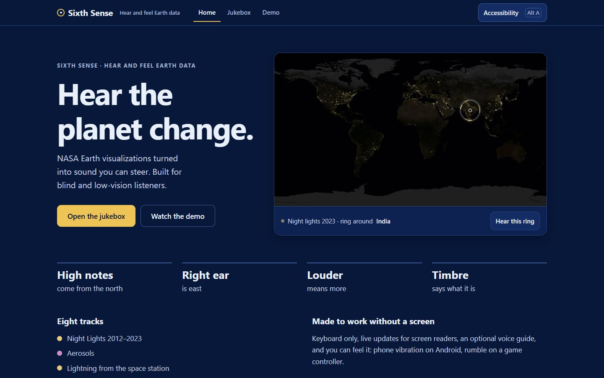
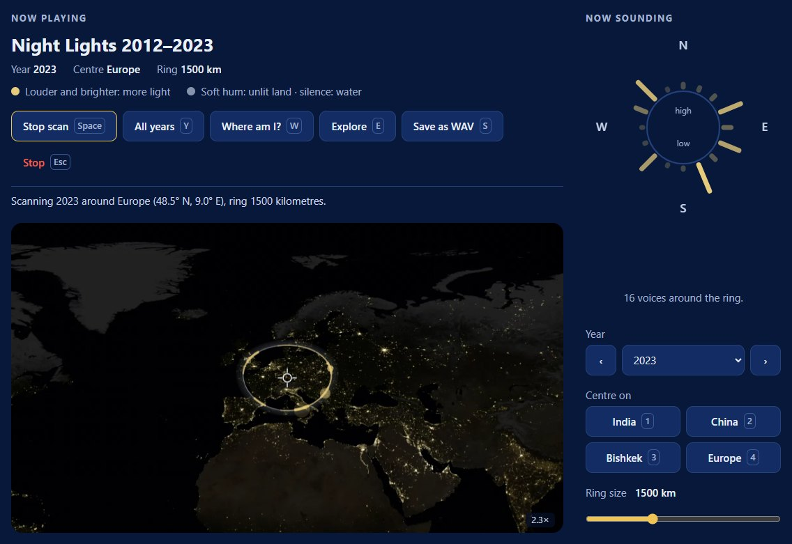
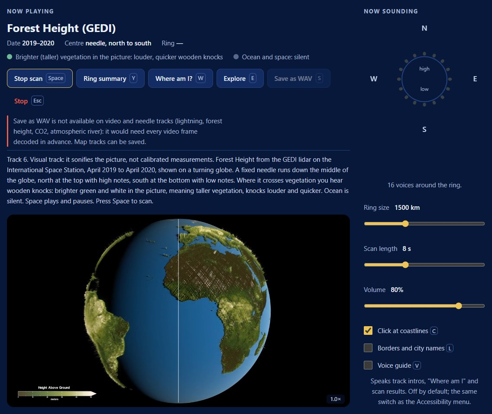
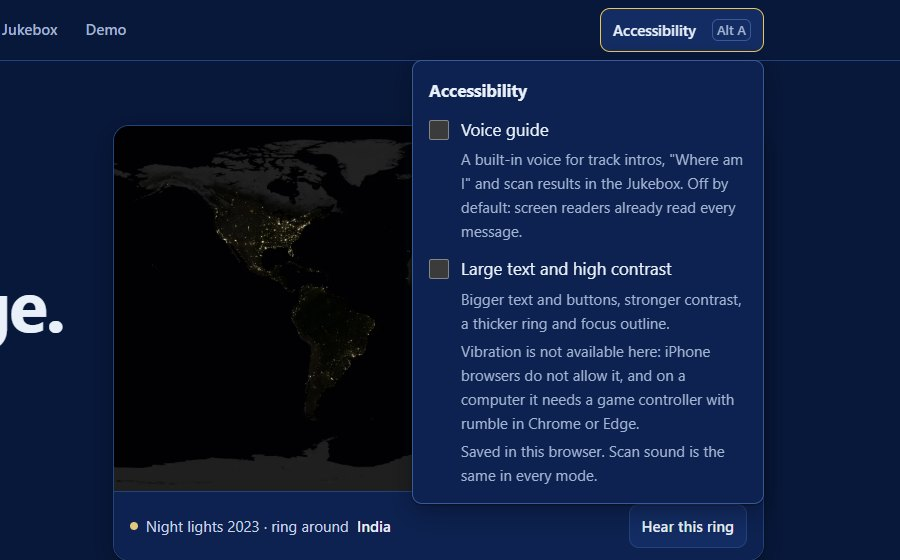
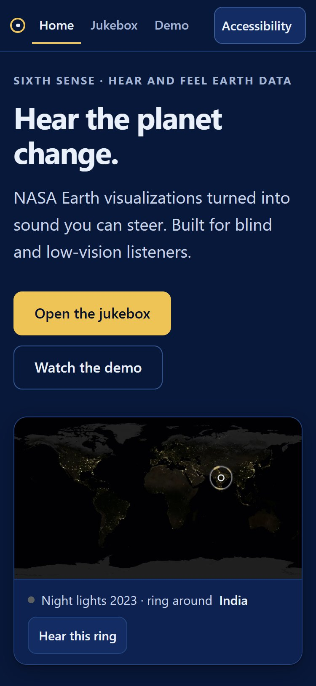
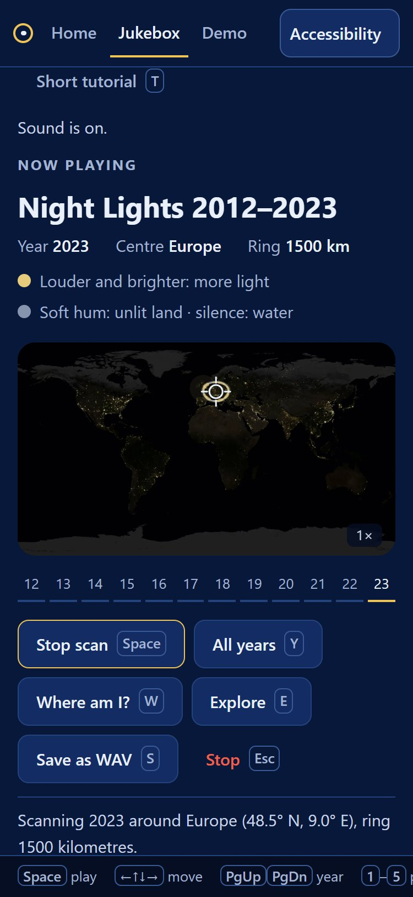

# Sixth Sense — Hear and feel Earth data

**Team Rococo**

Members:

- Dzhanteliev Adilkhan
- Sakybaev Meder
- Osmonbaev Aibek
- Emilev Bektur

Ala-Too International University, Bishkek, Kyrgyzstan
NASA Space Apps Challenge 2026, 14–15 November 2026
Challenge: **The Earth Information Jukebox**

| | |
|---|---|
| Live site | https://earthsonar.vercel.app |
| Demo (28 seconds, English captions) | https://earthsonar.vercel.app/#demo |
| Slides (7 pages, PDF) | [docs/SixthSense-slides.pdf](docs/SixthSense-slides.pdf) |
| Sound design, track by track | [docs/SOUND_DESIGN.md](docs/SOUND_DESIGN.md) |



## Summary

**What it is.** Sixth Sense is a web jukebox that turns NASA Earth Information Center
visualizations into live sound and vibration. You choose one of eight tracks and a place on
Earth; a ring of sound closes in on that place and you hear what the map shows around it.

**Why it matters.** Earth science reaches the public almost only as pictures. Someone who
cannot see a map gets none of it. Sixth Sense gives the same visualizations a second and a
third channel: hearing and touch.

**How it answers the challenge.** The challenge asks for an "Earth Jukebox" that pairs EIC
visual frames with dynamic sonifications generated in real time, with accessibility as a core
theme. Sixth Sense reads the pixels of NASA SVS frames in the browser and synthesises every
sound at the moment of listening. Nothing is pre-recorded. It works from the keyboard alone
and with screen readers.

## Problem

According to the World Health Organization, at least 2.2 billion people have a near or
distance vision impairment
([WHO fact sheet, "Blindness and vision impairment"](https://www.who.int/news-room/fact-sheets/detail/blindness-and-visual-impairment)).
NASA's visualizations of night lights, aerosols, storms and oceans are made for the eye, so
this audience is left out of some of the clearest stories about our changing planet. An image
sonification that sweeps a line across the picture gives time order, but no sense of *where*
things are around a place the listener cares about.

## Solution

**One idea:** a ring of sound that shrinks onto a point you choose, so the map becomes an
audible compass.

- High notes come from the north, low notes from the south.
- The left ear is west, the right ear is east.
- Louder and brighter means more.
- The instrument tells you what it is: lightning cracks, dust rustles, smoke crackles, wind
  rushes, forest is struck wood.

**What is new compared with a line scan.**

1. **Direction and distance.** The ring is centred on the listener's own place: "a loud, high
   sound in my right ear" means "something strong to the north-east". What sounds first is far
   away, what sounds last is close.
2. **Touch.** The same values drive phone vibration on Android and rumble on a game
   controller.
3. **Exploring, not only playing.** Move the centre with the arrow keys, ask "Where am I?",
   explore point by point, compare years.
4. **Honest classes.** Five tracks are *Data-true* (values read back from the visualization's
   own colour scale). Three are *Visual* (they sonify the picture and say so).



## How it works

### NASA data

All frames come from the NASA Scientific Visualization Studio (SVS). Seven of the eight are in
the challenge's own resource list; the wind frame (5148) is an SVS page tagged Earth
Information Center.

| # | Track | NASA SVS visualization | Class · scan |
|---|---|---|---|
| 1 | Night Lights 2012–2023 | [Change in Night Lights between 2012 and 2023 – EIC Version (5313)](https://svs.gsfc.nasa.gov/5313/) | Data-true · ring |
| 2 | Aerosols | [GEOS Aerosols (5669)](https://svs.gsfc.nasa.gov/5669/) | Data-true · ring |
| 3 | Lightning | [Lightning Events Detected from the ISS 2017–2023 (5011)](https://svs.gsfc.nasa.gov/5011/) | Data-true · ring on video |
| 4 | Ocean Temperature | [Global Sea Surface Currents and Temperature (3912)](https://svs.gsfc.nasa.gov/3912/) | Data-true · ring |
| 5 | Near-Surface Wind | [GEOS-FP Near-Surface Wind Speed (5148)](https://svs.gsfc.nasa.gov/5148/) | Data-true · ring |
| 6 | Forest Height (GEDI) | [GEDI Forest Height (4950)](https://svs.gsfc.nasa.gov/4950/) | Visual · needle on a turning globe |
| 7 | Carbon Dioxide (DYAMOND) | [DYAMOND Global Carbon Dioxide (5196)](https://svs.gsfc.nasa.gov/5196/) | Visual · needle on an orbiting globe |
| 8 | Atmospheric River | [A 3D View of an Atmospheric River from an Earth System Model (4960)](https://svs.gsfc.nasa.gov/4960/) | Visual · needle sweep over a still |

Source collection:
[NASA Earth Information Center content database](https://svs.gsfc.nasa.gov/gallery/earth-information-center/).
File addresses, sizes, download dates, SHA-256 checksums and every measurement made on the
frames are in [docs/DATA_NOTES.md](docs/DATA_NOTES.md).

### Method

1. **Prepare.** `tools/prepare_media.py` crops each frame to one clean world map, removes
   overlays, and writes two files: a lossless *sound grid* (the exact values the sonification
   uses, so compression can never change a sound) and a lossy *view* for the eyes.
2. **Read.** In the browser a ring of 16 voices is laid on the sphere around the chosen point
   (great-circle geometry, not pixels). Each voice averages the values on its own arc, 30 times
   a second, as the ring shrinks.
3. **Sound.** Web Audio synthesises each voice live. Direction sets pitch (a major pentatonic
   scale, so any combination is consonant) and stereo position; the value sets loudness and
   brightness; the phenomenon sets the instrument. All scales are fixed: the same sound always
   means the same pixel value, in every year and place.
4. **Report.** The scan ends with one note for the value at the centre and a sentence in a
   live region for screen readers.

Globe videos and 3D stills have no flat map, so tracks 6–8 use a **needle**: a vertical line of
12 voices (top is high) that reads the pixels passing under it.

Every formula, threshold and instrument is written down in
[docs/SOUND_DESIGN.md](docs/SOUND_DESIGN.md).



### AI tools and what they were used for

- **Claude (Anthropic), through Claude Code:** wrote the code (web app, tests, media
  preparation scripts, the firmware kept for future work) and drafted the documentation, under
  the team's direction. The team chose the idea, the datasets and the sound rules, and
  reviewed, ran and tested the result.
- **No AI-generated images, video or audio.** Every image is an original NASA SVS frame; every
  sound is synthesised live from pixel values by fixed, documented rules.
- No machine learning runs in the product: a transparent ruleset lets every sound be traced
  back to a pixel.
- No NASA logos or insignia are used or modified.

### Stack

- A static website: plain HTML, CSS and JavaScript modules, no build step and no third-party
  JavaScript libraries.
- Browser APIs: Web Audio, Canvas 2D, Web Speech, Gamepad, Vibration.
- Media preparation: Python, NumPy, Pillow, FFmpeg.
- Tests: the Node.js built-in test runner (89 unit tests) and headless-Chrome checks.
- Hosting: Vercel (static).

## Demo

- **Watch:** https://earthsonar.vercel.app/#demo plays a 28-second demo with English captions:
  night lights over Europe, aerosols over Africa, lightning seen from the space station.
- **Try:** open https://earthsonar.vercel.app/#jukebox, press **Space**, and listen with
  headphones. Sound starts after the first key press or click, as browsers require.

| Key | Action |
|---|---|
| Space | Play or stop a scan |
| Shift + 1…8 | Choose a track |
| 1…5 | Jump to one of the track's places |
| Arrow keys (Shift = ×5) | Move the centre |
| Page Up / Page Down | Next / previous year (night lights), a month (lightning) |
| `.` / `,` | Bigger / smaller ring |
| Y | Summary of the ring, or all years on night lights |
| W | Where am I? |
| E | Explore point by point |
| T | Short sound tutorial |
| S | Save the scan as a WAV file (map tracks) |
| L · C · V | Map labels · coastline clicks · voice guide |
| + / − / 0 | Zoom the picture |
| Alt + A | Accessibility menu |
| Esc | Stop all sound |

### Accessibility

- Everything works from the keyboard; every action is also a labelled button.
- A live region announces every action and result; a screen reader reads them without extra
  setup.
- The Accessibility menu comes first on every page: an optional voice guide (off by default),
  large text with high contrast, and Haptics where the device supports it.
- `prefers-reduced-motion` is respected; nothing flashes more than about twice a second.
- AA contrast, colour-blind-checked data colours.



### Haptics: phone vibration on Android, rumble on a game controller

- **Android phone (Chrome):** pulses of 10 to 60 ms, longer for a higher value under the scan.
- **Game controller (Chrome or Edge):** the left stick moves the centre, A starts the scan,
  X says where you are. The heavy motor carries the south (low notes), the light motor the
  north (high notes).
- The Haptics switch is shown only where vibration works. iPhone and iPad browsers do not
  offer vibration, and a computer needs a controller with rumble.
- Checked in browser emulation only. We have not yet tested it on physical devices.

 

## Impact and next steps

**Who benefits.** Blind and low-vision people first: visitors of science centres, students,
anyone curious about the planet. Everyone else gets a new way to notice patterns, because the
ear follows several directions at once.

**Reach.** It is a web page: no install, no account, no special hardware. It runs on a
laptop or a phone.

**Limits we state openly.**

- We sonify the rendered visualization, not raw measurements. Pixel colours are the SVS
  display mapping, not calibrated radiance, mass or counts.
- Night-lights pixels are about 21 km wide; the brightest city cores saturate.
- The aerosol legend has no numbers: type is reliable, amount is relative.
- Lightning is seen only between about 52° north and south; silence beyond that means
  "no data".
- Ocean temperature is one model day (19 June 2007), not a trend.
- Wind reads from 3.6 to 34 m/s.
- Tracks 6–8 are Visual: they say where the picture has colour, not calibrated values.
- Designed for blind and low-vision users. It has **not** yet been tested with blind users,
  and the planned blindfolded listening test has not been run, so we quote no results.

**Next steps.**

1. Listening tests: first blindfolded with sighted volunteers, then with blind and
   low-vision users, and publish the measured results.
2. Test haptics on real Android phones and controllers.
3. More EIC visualizations as tracks, and time series for the ocean and wind.
4. Interface translations.

### Future work already in the repository

- **A tactile controller.** We designed an Arduino controller (joystick, year knob, button,
  four vibration motors) with a text protocol over Web Serial:
  [docs/PROTOCOL.md](docs/PROTOCOL.md),
  [firmware/earthsonar_controller](firmware/earthsonar_controller/earthsonar_controller.ino),
  `js/serial.js` and its tests. It was designed and checked against an emulated board only.
  It has never been tested on a physical device, and the site does not use it.
- **A ninth track** (Perpetual Ocean 2, SVS 5425) is prepared in the code but disabled on the
  site.

## Team and references

**Team Rococo:** Dzhanteliev Adilkhan, Sakybaev Meder, Osmonbaev Aibek, Emilev Bektur.

### NASA data and credits

- **Change in Night Lights between 2012 and 2023 – EIC Version**, SVS 5313,
  https://svs.gsfc.nasa.gov/5313/. NASA's Scientific Visualization Studio; visualizer
  Kel Elkins (USRA); scientists Zhuosen Wang, Miguel Román, Ranjay Shrestha, Srija
  Chakraborty, Virginia Kalb. Data: NASA Black Marble, Suomi NPP VIIRS.
- **GEOS Aerosols**, SVS 5669, https://svs.gsfc.nasa.gov/5669/. NASA Global Modeling and
  Assimilation Office and NASA's Scientific Visualization Studio; visualizers Joseph V.
  Ardizzone, Helen-Nicole Kostis; scientist Lesley Ott. Data: GEOS-FP 2 km Replay,
  DOI 10.5281/zenodo.21893141.
- **Lightning Events Detected from the International Space Station (ISS) 2017–2023**,
  SVS 5011, https://svs.gsfc.nasa.gov/5011/. NASA's Scientific Visualization Studio;
  visualizers Michala Garrison, Greg Shirah, Kel Elkins, Alex Kekesi. Data: Blakeslee, R. J.
  2020, Quality Controlled Lightning Imaging Sensor (LIS) on International Space Station (ISS)
  Science Data, NASA Global Hydrology Resource Center DAAC.
- **Global Sea Surface Currents and Temperature**, SVS 3912, https://svs.gsfc.nasa.gov/3912/.
  NASA/Goddard Space Flight Center Scientific Visualization Studio; animators Greg Shirah,
  Horace Mitchell, Eric Sokolowsky; scientists Hong Zhang, Dimitris Menemenlis. Data: ECCO2.
- **GEOS-FP Near-Surface Wind Speed**, SVS 5148, https://svs.gsfc.nasa.gov/5148/. NASA's
  Global Modeling and Assimilation Office; visualizer Joseph V. Ardizzone. Data: GEOS-FP.
  The agency logos printed on that frame are painted over in our copy.
- **GEDI Forest Height**, SVS 4950, https://svs.gsfc.nasa.gov/4950/. NASA's Scientific
  Visualization Studio; visualizers Kel Elkins, Horace Mitchell, Greg Shirah; scientists
  Temilola Fatoyinbo, Atticus Stovall. Data: GEDI L2B RH100.
- **DYAMOND Global Carbon Dioxide**, SVS 5196, https://svs.gsfc.nasa.gov/5196/. NASA's
  Scientific Visualization Studio; visualizers AJ Christensen, Greg Shirah, Helen-Nicole
  Kostis, Mark SubbaRao; scientists Lesley Ott, Brad Weir, William Putman, Tomohiro Oda.
  Data: DYAMOND (GEOS-MITgcm).
- **A 3D View of an Atmospheric River from an Earth System Model**, SVS 4960,
  https://svs.gsfc.nasa.gov/4960/. NASA's Scientific Visualization Studio; visualizers Greg
  Shirah, Horace Mitchell, Cindy Starr, Kel Elkins; scientists Allison Collow, Natalie
  Thomas, Michael Bosilovich. Data: MERRA-2.

### Method references

- Data Sonification: Caldwell 73, NASA SVS 13786, https://svs.gsfc.nasa.gov/13786/ (listed in
  the challenge resources).
- Sonification of RS Puppis, NASA SVS 14260, https://svs.gsfc.nasa.gov/14260/: a ring moving
  towards the centre of an image. We reuse only the principle; no part of that image or audio
  is used.

### Other data, tools and open resources

- World Health Organization, "Blindness and vision impairment" fact sheet,
  https://www.who.int/news-room/fact-sheets/detail/blindness-and-visual-impairment.
- Natural Earth 1:110m country borders and populated places (public domain,
  https://www.naturalearthdata.com): an optional visual label layer, never sonified.
- FFmpeg (LGPL/GPL), Python, NumPy (BSD), Pillow (MIT-CMU), Node.js.
- Claude (Anthropic), as described under "AI tools" above.

### Run it yourself

```bash
python tools/dev_server.py 8766        # then open http://localhost:8766/
node --test "tests/*.test.js"          # unit tests
node tools/track_switch_check.mjs http://localhost:8766/   # browser check of the scan button
python tools/prepare_media.py          # rebuild media/ from the raw SVS files (ffmpeg, numpy, Pillow)
node tools/screenshots.mjs https://earthsonar.vercel.app/  # docs/screenshots
node tools/build_slides.mjs http://localhost:8766/         # docs/SixthSense-slides.pdf
```

The page must be served over http(s); opening `index.html` as a file will not work, because
the browser may only read pixels of files from the same origin.

| Folder | Contents |
|---|---|
| `index.html`, `css/`, `js/` | the site |
| `media/`, `manifest.json` | prepared NASA frames and their index |
| `docs/` | sound design, data notes, sound measurements, submission texts, slides |
| `tests/`, `tools/` | unit tests; media preparation, screenshots, slides and browser checks |
| `firmware/` | future work: the controller firmware |

Sixth Sense is an independent NASA Space Apps Challenge project. It is not affiliated with or
endorsed by NASA.
